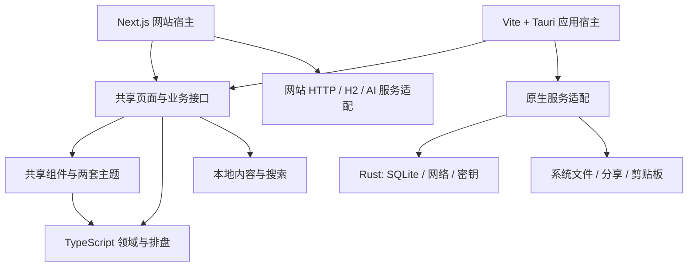

# 紫微命盘四端应用迁移方案

> 执行对象：GPT-6.1sol。目标技术栈：React + TypeScript + Vite + Tauri 2。目标平台：Android、iOS、macOS、Windows。
>
> 方案日期：2026-10-31。代码核对基线：`7404915`。这是实施方案，本轮仅新增此文档，尚未执行技术栈迁移。
>
> 已纳入补充要求：同步调整启动/关闭脚本，支持本地 Web；代码推送 GitHub 后，通过 GitHub Actions 的多操作系统 runner 自动打包并上传构建产物。

## 1. 目标与默认决策

将现有紫微斗数项目改造为可安装的四端应用，复用已有排盘算法、页面和两套主题。安装后，排盘、命盘档案、已有古籍内容及搜索可以离线使用；AI 解读在配置模型并联网后使用。

按以下决策直接实施，无需再次让用户选择技术栈：

1. **应用端：React 19 + TypeScript + Vite + Tauri 2。** 四端共用 React 页面及 TypeScript 业务代码，使用少量 Rust、Kotlin、Swift 处理原生能力。
2. **网站端：保留 Next.js。** 继续承担现有网站、SEO 和网站 API。最终放在 `apps/web`；四端安装包不依赖这个服务才能启动、排盘或管理档案。
3. **共享代码：npm workspaces。** 继续使用 npm 和现有锁文件体系。本次不顺带迁移 pnpm、Tailwind 4、全新状态管理库或另一套组件库。
4. **本地档案：SQLite。** 原生应用通过 Rust 数据访问层读写，H2/Java 留给网站及旧数据导出工具。应用安装包不包含 Node.js、Java、Next.js 服务或本地 HTTP 服务。
5. **AI：保留用户自填 Base URL、模型、API Key，以及 Chat Completions / Responses 两种协议。** 应用端通过原生网络层直连用户配置的服务；网站继续使用原有服务端代理。首版不强制用户另行部署后端。
6. **界面：保留「玄青星图」「宣纸墨金」。** 以最近一轮已完成的设计为视觉基线，主要做 WebView、手机交互和系统安全区适配。
7. **数据：首版按设备本地保存。** 提供版本化 JSON 导入/导出。多端安装不等于数据自动同步；账号、云同步、订阅、推送不纳入本次迁移。
8. **发布：交付构建配置、验证记录和可获得的安装产物。** 商店正式上传、证书申请、生产域名配置属于后续发布操作，不因缺少这些条件阻塞可独立完成的迁移工作。
9. **本地启停：同步维护 `scripts/start.sh` / `scripts/stop.sh`。** 默认仍能一键启动、关闭完整的本地 Web；迁移后覆盖 workspace 路径、进程树、日志、端口、环境配置与健康检查，并提供 Windows 可用入口。
10. **GitHub 自动打包：分支 push 自动触发验证和多平台构建。** 使用 Ubuntu、Windows、macOS runner 分别完成 Web、Android、Windows、macOS、iOS 对应构建，下载入口为 Actions artifacts；版本标签或手动执行可进入签名流程。

## 2. 已核对的项目现状

当前实际项目目录是 `/Users/wanghongfei/work/work-space/ziwei-doushu`。会话中出现过的 `/Users/wanghongfei/work/work-space/ziwei-doushu-main` 当前不存在。执行前重新确认路径和 Git 状态，以实际工作区为准。

- 应用开发服务原为 `http://localhost:3000`；`http://localhost:3011` 是视觉对比图库，不是待迁移应用。
- 当前依赖为 Next.js `16.3.8`、React `19.2.5`、TypeScript、Tailwind CSS 3、Framer Motion。
- `@types/react` / `@types/react-dom` 目前为 18 系列，迁移时应与 React 19 对齐并修复类型问题。
- 排盘核心在 `lib/ziwei/`，包括 `algorithm.ts`、`sihua.ts`、真太阳时、夏令时、晚子时、流派配置等。
- `BirthFormState` 定义在 `components/BirthForm.tsx`，却被领域模块引用，需要先移到公共类型层。
- `lib/ziwei/history.ts` 包含 React hook 和 localStorage；`school-config.ts` 混合规则配置与浏览器持久化。因此不能把整个 `lib/ziwei` 原样当成纯算法包。
- 档案调用 `/api/profiles`，经 `lib/db/profiles.ts`、`lib/db/h2.ts` 启动 `server/h2/ProfileStore.java`，保存到 H2。
- 档案 ID 是**规范化表单 JSON 的 SHA-256**，不是 UUID；编辑资料可能改变 ID，更新必须原子完成并防止覆盖另一个档案。
- `lib/ai/settings.ts` 通过 Node 文件系统保存模型配置；`lib/ai/server.ts` 负责上游请求、超时及 SSE 转换。
- `lib/ai/prompts.ts` 虽然主要是校验和提示词拼装，但引用了 `server-only` 和服务端错误类型，需要拆分后复用。
- `lib/classics` 的古籍与搜索可在本地运行；`lib/nihai` 等已有内容按实际引用迁移，不下载外部巨型数据集。
- 已确认 `lib/classics/data/gusuifu.ts`、`quanji.ts`、`quanshu.ts` 在当前磁盘存在，但被 `.gitignore` 的 `data/` 规则忽略，未进入 Git 跟踪。创建新检出目录或隔离构建时要显式保留这些源码，迁移时修正忽略范围并纳入内容包。
- 当前 `STAR_DB` 为空，知识详情缺内容是源码现状；保留已有介绍、定位链接及未收录提示，不生成虚构文章补空。
- `components/ShareCardCanvas.tsx` 使用 html2canvas 与浏览器下载，`ShareModal.tsx` 使用浏览器剪贴板，需要原生适配。
- `next/link`、`next/navigation`、Next Metadata、网站统计和 `process.env.NEXT_PUBLIC_*` 存在于页面及组件中，必须与应用端隔离。
- 当前 `scripts/start.sh` / `stop.sh` 直接识别根目录 Next CLI，使用 `.runtime/dev.pid` / `dev.log`，Node 检查仍是 20.9+；迁移 workspace 和更新工具链时必须一起改造。
- 当前 `.github/workflows/ci.yml` 只有 Ubuntu 上的类型检查和回归测试，push 仅覆盖 `main`，尚未实现四端自动打包或安装产物上传。

已有回归入口：`npm run typecheck`、`npm test`，覆盖 AI 流、模型配置、H2 档案及多项历法/排盘规则。迁移不能删除这些验证来使构建通过。

视觉参考位于 `.runtime/ui-review/REVIEW.md` 和 `.runtime/ui-review/after/`；设计原图在 `output/imagegen/`。这些本地文件在其他检出目录可能不存在，缺失时先从当前网站补采两套主题基线，不把缺图当成重新设计的理由。

## 3. 目标目录与依赖边界

```text
ziwei-doushu/
├── apps/
│   ├── web/                         # 原 Next.js 网站、API、SEO
│   │   ├── app/
│   │   ├── lib/server/               # 网站 AI / H2 适配
│   │   ├── server/h2/
│   │   ├── vendor/h2/
│   │   ├── public/
│   │   └── next.config.js
│   └── native/                      # 四端共用的 Vite 应用
│       ├── src/
│       │   ├── main.tsx
│       │   ├── router.tsx
│       │   ├── bootstrap.ts
│       │   └── adapters/            # Tauri 能力 → 业务接口
│       ├── public/
│       ├── vite.config.ts
│       └── src-tauri/
│           ├── src/
│           │   ├── lib.rs
│           │   ├── db.rs
│           │   ├── ai.rs
│           │   ├── secrets.rs
│           │   └── commands.rs
│           ├── migrations/
│           ├── capabilities/
│           ├── icons/
│           ├── gen/                # Android / iOS 工程，按 CLI 模板管理
│           ├── Cargo.toml
│           ├── Cargo.lock
│           └── tauri.conf.json
├── packages/
│   ├── domain/                      # 纯 TS：排盘、表单模型、序列化、规则
│   ├── content/                     # 已有古籍、知识介绍、搜索
│   ├── ui/                          # 共享 React 组件、主题、导航抽象
│   └── features/                    # 页面业务、服务接口、AI 纯逻辑
├── assets/                          # 两端共用的原始品牌/山水素材
├── scripts/                         # 回归、资源同步、数据导出、构建辅助
├── docs/
├── package.json                     # workspaces 与统一命令
└── package-lock.json
```

依赖方向：



实施约束：

- `domain` 禁止依赖 React、Next、Tauri、Node 内置模块、DOM 和存储；计算输入与流派配置显式传入。
- `content` 不依赖服务器文件系统，按书籍/功能分块加载；搜索覆盖实际已有内容。
- `ui` / `features` 不直接 import `next/*` 或 `@tauri-apps/*`，不直接调用 `/api/*`。
- 共享层通过接口使用档案、设置、AI、分享能力。Tauri API 仅出现在原生适配层。
- Next 页面保留宿主路由和 SEO 包装；不要为了共享把所有静态阅读页都改成客户端组件。
- 包声明显式 `exports` 和依赖。React / React DOM 放在共享组件包的 peerDependencies，保证运行时只有一份。
- 不保留两份独立演进的排盘算法，也不建立指向旧项目根目录的长期别名来掩盖未完成迁移。
- 调整 `.gitignore` 时区分私人数据库目录与源码数据目录，修复已确认的静态内容误忽略。已有古籍源码应随 `packages/content` 版本管理，个人数据库仍须忽略，保留内容的原始许可与引用信息。

## 4. 页面、路由与样式迁移

### 4.1 保留页面范围

原生端实现与现有功能对应的路由：

```text
/
/qipan
/chart                       # 空表单、URL 参数起盘、档案起盘、已生成命盘
/heming
/profiles
/settings/model
/knowledge
/knowledge/:star/:topic      # 仅显示真实存在的内容，否则未收录状态
/library
/library/search
/library/:book
/library/:book/:chapter
/privacy
/terms
/preview
*                            # 统一未找到页面
```

网站继续用 Next App Router；原生端使用 React Router 的 HashRouter / createHashRouter，避免安装包路由刷新依赖服务器重写。保留路径、查询参数和章节定位的业务含义，不要求两种宿主的地址字符串完全相同。

具体修改：

- `next/link` 改为共享 `AppLink`，由宿主注入 Next Link 或 React Router Link；外链独立走 `openExternal`。
- `useRouter` / `usePathname` 转为宿主导航接口，覆盖 push、replace、back、当前路径。
- `useSearchParams` 由宿主提供。HashRouter 的参数从路由对象读取，不能直接读 `window.location.search`。
- Next 的 `notFound()`、异步 `params`、`generateStaticParams`、metadata 留在网站包装层；应用端使用普通参数与状态组件。
- 验证 `/chart?profile=...`、生辰分享参数、古籍搜索参数、章节锚点、返回键和重新起盘，不只是菜单链接可点击。
- `lib/site.ts` 改为宿主配置输入，网站读取 `NEXT_PUBLIC_SITE_URL`，应用读取公开的网站分享地址。应用分享不能输出 `tauri://`、`localhost` 或本机档案 ID 链接。
- 首版保证复制 HTTPS 分享链接和“粘贴链接导入起盘”；App Links / Universal Links 需要域名关联，可后续增加，不作为首版启动依赖。

### 4.2 保留视觉成果

- 迁移 `app/globals.css`、`app/celestial.css`、相关 CSS Modules、ThemeProvider、ThemeToggle 和所有主题变量，包含命盘使用的 `--t-*`。
- 保留山水 WebP、星轨 SVG、宋体标题、四化语义色、12 宫布局和单一时间导航。
- Tailwind 3 的 content 路径必须包含共享包；两端使用相同的主题预设和样式加载顺序。
- 共享素材保存一份，由可重复执行的脚本同步到各宿主 public；通过宿主资源 URL 解析，核对 Vite 生产包中的背景图、图标和深层路由，不依赖开发服务器路径。
- 主题优先级为已保存用户选择，其次沿用当前默认深色；启动时在首帧设置主题，避免浅色闪屏。网站继续处理 SSR hydration，原生 Vite 不复制 Next 的 SSR 代码。
- 保留现有字体回退；如需统一四端字形，使用许可清楚、体积受控的本地字体，验证中文、异体字及离线显示，不依赖在线字体 CDN。

## 5. 领域模型和服务接口

### 5.1 先拆类型，再迁页面

1. 将 `BirthFormState`、`BirthProfile`、`HistoryEntry` 移到 `packages/domain`，组件改为引用类型。
2. 保留 `parseProfileForm` 的日期合法性、字段规范化及固定字段顺序。
3. 将 `formToBirthInfo`、分享参数编码/解码、档案规范化序列化迁入领域层；不要顺带改变经度、未知时辰或晚子时规则。
4. 将 `school-config.ts` 的类型、默认值、参数序列化与 localStorage 读写拆开；`history.ts` 的 React hook 进入 features，存储经过接口。
5. 排盘算法继续用现有实现。当前年龄依赖当前年份，比较测试固定时钟/参考年份；不要把运行日期变化误判成迁移误差。
6. 日期运算不能偷偷按设备时区改出生信息。跨宿主验证原始钟表时间、日期进位、经度和现有规则结果一致。

### 5.2 最小接口约定

以下是接口方向，落地时补齐具体类型；不要另建与它平行的调用通道：

```ts
interface ProfileRepository {
  list(): Promise<BirthProfile[]>;
  get(id: string): Promise<BirthProfile | null>;
  save(form: BirthFormState): Promise<BirthProfile>;
  update(id: string, form: BirthFormState): Promise<ProfileUpdateResult>;
  remove(id: string): Promise<boolean>;
}

interface ProfileTransfer {
  exportData(): Promise<ProfileExportV1>;
  importData(data: unknown): Promise<ImportSummary>;
}

type ProfileUpdateResult =
  | { kind: 'updated'; profile: BirthProfile }
  | { kind: 'duplicate' }
  | { kind: 'not-found' };

type AIEvent =
  | { type: 'delta'; text: string }
  | { type: 'done' }
  | { type: 'error'; code: string; message: string };

interface AIService {
  stream(request: AIRequest, signal: AbortSignal): AsyncIterable<AIEvent>;
  testConnection(draft: ModelSettingsDraft, signal: AbortSignal): Promise<ConnectionTestResult>;
}

interface PlatformFiles {
  importJSON(): Promise<string | null>;
  exportJSON(filename: string, contents: string): Promise<FileActionResult>;
  exportImage(filename: string, bytes: Uint8Array): Promise<FileActionResult>;
  copyText(text: string): Promise<void>;
  openExternal(url: string): Promise<void>;
}
```

另设 `PreferencesRepository` 与 `ModelSettingsRepository`，分别管理主题/流派/历史及模型公开配置。模型配置读取接口返回 `hasApiKey` 等状态，默认不返回已保存密钥原文。保存、替换、清除密钥是明确的独立操作。

网页与应用分别实现 CRUD、AI 和平台接口。原生端必须完整实现 ProfileTransfer；网站首版提供导出入口或使用本地导出脚本，不额外扩展 H2 的批量导入功能。共享业务组件通过 Provider 或显式参数获得服务，以能力是否存在决定导入入口，不在每个按钮里判断操作系统。

## 6. SQLite 与旧档案迁移

### 6.1 存储实现

默认采用 **Rust + sqlx SQLite** 的窄接口，连接池、事务和 schema migration 由 Rust 持有。SQLite 以随应用编译的实现提供，不依赖用户机器安装数据库。

不同时引入另一套 SQLite 写入方案。官方 SQL 插件虽可选，但此项目存在多语句原子编辑和批量导入，直接由 Rust transaction 完成更清晰；不要在 JS 连续发送 `BEGIN`、`UPDATE`、`COMMIT` 并假定连接池会使用同一连接。

首版表结构建议：

```sql
CREATE TABLE birth_profiles (
  id TEXT PRIMARY KEY NOT NULL,
  form_json TEXT NOT NULL,
  saved_at INTEGER NOT NULL
);

CREATE INDEX birth_profiles_saved_at
  ON birth_profiles(saved_at DESC, id);

CREATE TABLE app_settings (
  key TEXT PRIMARY KEY NOT NULL,
  value_json TEXT NOT NULL
);

CREATE TABLE recent_history (
  id TEXT PRIMARY KEY NOT NULL,
  form_json TEXT NOT NULL,
  saved_at INTEGER NOT NULL
);
```

schema 版本由选定的 migration 机制统一管理；不要再用另一套版本号覆盖它。API Key 不进入这些表。

数据库放在 Tauri 提供的应用私有数据目录，不能放在安装目录、当前工作目录或静态资源目录。配置合理 busy timeout，并保证异步数据库操作不阻塞 UI/主线程。

### 6.2 保持现有档案语义

- ID 沿用 `SHA-256(UTF-8(canonicalFormJSON))`，规范化字段顺序必须与现有 `parseProfileForm` 返回顺序一致。
- TypeScript 生成规范化 JSON；Rust 校验格式、字段和大小后按该字符串计算哈希并绑定 SQL 参数。不得用 Rust map 重新排列键、格式化数字后再计算不兼容 ID。用既有样本跨语言验证哈希一致。
- 同一资料重复保存只保留一条，并按现有逻辑更新保存时间；同生日但姓名不同的资料仍是不同档案。
- 编辑改变 ID 时，在同一事务中检查原记录、检测目标重复、写入目标和删除原记录；任何失败都回滚。
- 编辑完成返回新 ID，界面与路由使用新 ID；旧链接找不到记录时显示恢复入口。
- 保留原始出生钟表时间。读取和保存不预先执行晚子时进位；起盘时通过原有转换路径只处理一次。
- 删除、存储失败、重复冲突、档案不存在分别给出准确结果，不能用成功提示掩盖错误。
- 最近历史继续保留现有上限和去重含义，不把“最近历史去重”错误复用为“档案唯一性”。

### 6.3 H2 → JSON → SQLite

新增本地导出脚本，例如 `scripts/export-h2-profiles.ts`，复用旧 H2 读取路径，显式指定数据目录与目标文件。正常关闭桥接进程，不读取生产库后顺带修改或删除它。

交换格式：

```json
{
  "format": "ziwei-profiles",
  "version": 1,
  "exportedAt": "ISO-8601 UTC 时间",
  "profiles": [
    { "id": "64 位十六进制哈希", "form": {}, "savedAt": 0 }
  ]
}
```

上面是结构示意；实际文件必须包含完整、通过验证的表单及真实时间戳。

导入流程：

1. 选择文件 → 限制文件大小和条数 → 验证格式版本、所有表单、ID 与时间戳。
2. 预览总数、待新增、重复、错误。未知版本或存在非法记录时不写入，展示可定位的错误。
3. 用户点击导入后，以单一事务写入；默认完全相同的档案跳过并保留本机时间，新增记录保留原始 `savedAt`。
4. 发生同 ID 不同内容时中止并报告，不覆盖。输出新增/跳过数量，重复导入不会复制记录。
5. 验证导入前后数量、规范化内容、晚子时起盘结果，并提供原生端再导出比对。

浏览器 localStorage 与原生 WebView 不是同一存储空间。网站可提供显式导出主题、流派及历史的版本化备份，应用端导入；不能声称安装后能自动读取 Chrome/Safari 的旧数据。AI 密钥不随普通资料备份导出，应用端重新填写。

不能把 `.mv.db` 改名为 `.sqlite`，也不能把用户 H2、SQLite、AI 配置或备份文件打进安装包。

## 7. AI、设置与流式响应

### 7.1 拆分已有逻辑

- 从 `lib/ai/prompts.ts` 提取纯校验、`interpretMessages`、`hemingMessages` 和公共消息类型，移除对服务端模块的反向引用。
- 从 `lib/ai/server.ts` 提取两种协议的请求体构造和流事件解释规则；Next 的 `Request`/`Response` 包装留在 web。
- 保留 `lib/ai/stream.ts` 的跨分片 UTF-8、SSE 多行、终止标志及错误处理能力。
- 原生 Rust 负责请求和密钥注入，通过 Tauri Channel 按序交付上游字节/状态；共享 TS 解析为 `AIEvent`。首版不把整套提示词及 SSE 业务在 Rust 再写一份。
- 网站适配器继续读取现有 `/api/interpret`、`/api/heming` 的标准化 SSE，转换到相同的 `AIEvent`。
- `InsightPanel`、`ChatPanel`、合盘页面统一消费 `AIService`，不再直接 fetch API 路径。

### 7.2 原生网络实现要求

- Rust 使用 `reqwest` 等成熟流式客户端，验证所选 TLS 实现在四端的构建和证书校验。常规请求从已保存配置读取地址；连接测试允许提交经过同等校验的暂存配置，且不隐式保存。UI 不获得任意 HTTP 转发命令。
- 保留 Base URL 校验、两种 endpoint 拼接、消息数量/体积限制、180 秒总超时及现有认证/限流错误语义。
- 生产默认 HTTPS，验证 TLS。调试用 HTTP/局域网模型单独配置范围；不全局关闭 Android 网络安全或 iOS ATS。
- 不把手机上的 `localhost` 当成开发电脑。真机调试显式配置可访问的 LAN 地址；打包应用不依赖该地址。
- 请求使用唯一 requestId。取消、路由卸载、换盘、超时、进入后台后的连接终止都能释放上游连接；旧请求不得继续写入新命盘对话。
- Channel 接收器先注册再开始请求，结束后清理。按块传输并限制未处理队列，避免每个字符触发一次渲染。
- 开始收到流内容后不自动重放请求；认证、限流错误不盲目重试。
- 拒绝意外重定向，避免把 Authorization 带到其他主机；错误日志不输出密钥、完整出生资料或聊天内容。
- 用真实的持续分片响应验证逐步显示，不允许收完全文后伪装成打字流。

### 7.3 密钥保存

默认方案为 **Stronghold 加密保管 + 用户解锁密码**，封装为 Rust 侧 `SecretStore`，通过窄命令完成配置、解锁、锁定和清除。实施阶段先验证选定版本的 Rust API 与四端构建，业务层不依赖插件内部私有类型。

- 用户可选择“仅本次使用”，密钥只保留在本次进程内；选择持久保存时设置解锁密码，冷启动后解锁才使用 AI。
- 解锁密码不落盘，不使用代码中写死的密码或把解锁密钥和密文一起存 SQLite。使用标准 KDF 和每安装实例生成的随机 salt。
- 主题、模型名、地址等公开偏好可放 SQLite；API Key 放独立密钥库。配置页读取 `hasApiKey`、`locked`、`configured`，不用已保存 Key 回填输入框。
- 保留“空输入表示保留已有 Key”的既有语义，清除密钥使用单独操作；连接测试使用当前表单内容，未保存也能测试。
- 设置输入默认为密码框。编辑时密钥短暂经过表单和 IPC，提交后清空；日志、截图、诊断和导出均遮罩。
- 密钥库锁定或用户忘记密码不能影响档案和离线排盘；可以重建密钥库并重新填写 API Key，不能因此重置全部用户数据。
- 不把密钥放进 `VITE_*`、源码、Tauri 配置、安装包或工作流明文。

如果后续需要无密码解锁，可增加系统 Keychain / Keystore 适配；这不作为本轮交付前置条件。

### 7.4 网站 API 的边界

保留现有网站 API 行为以完成迁移回归，但不能把现有全局模型配置和无账号档案 API 直接宣称为多用户云服务。四端默认本地档案和个人 BYOK，不调用网站全局设置接口。

未来增加托管 AI 或云同步时再单独实现认证、用户隔离和服务端授权。该扩展不混入首版迁移。

## 8. 原生能力与四端交互

### 8.1 文件、图片与分享

- html2canvas 保留为图片生成方案，等待字体和图片完成加载，限制超大画布及 DPR；透明背景、中文、主题颜色都要验证。
- 桌面：使用系统保存对话框导出 PNG/JSON，取消操作返回取消状态；写入用户选择的路径，不依赖 `<a download>`。
- Android / iOS：导入走系统文档选择器；导出走文件提供器或系统分享面板，可保存到文件。首版不强制申请相册权限。
- Android 文档选择可能返回 `content://`，iOS 可能返回 `file://` URI；通过插件支持的 URI 读取能力或原生桥接读取，不一律当普通文件路径交给 Rust fs。
- 系统分享若所选稳定插件不覆盖两端，实现最小 Tauri mobile plugin：Android 用 FileProvider + ACTION_SEND，iOS 用 UIActivityViewController，配置正确的文件访问范围和 iPad 展示锚点。
- 分享临时文件在消费期间保留，按生命周期清理；禁止刚弹出分享面板就删除文件。
- 剪贴板使用平台适配，外部网站用系统浏览器；限制支持的 URL scheme，不把远程网页加载到拥有原生权限的主 WebView。
- 分享图片、分享链接均不意外包含 API Key、内部文件路径或仅在本设备有效的 `profile` ID。保留当前产品的姓名展示行为，并让导出动作与用户可见内容一致。

### 8.2 移动端布局

- 设置 `viewport-fit=cover`，统一处理 `env(safe-area-inset-*)`、状态栏、底部手势区及 `100dvh`。
- 验证键盘弹出时生辰表单、模型配置和 AI 输入框可见，发送按钮可操作；必要时适配 visualViewport，而非写死屏幕高度。
- 主页面不能横向溢出。命盘小屏保持 12 宫空间关系，允许命盘容器受控缩放/滚动或宫位详情抽屉，避免把星曜字号压到不可读。
- 点击宫位、切换流年、下拉选择、模态框滚动锁定适配触摸输入；常用触控区域至少约 44 CSS px。
- Android 返回键顺序：关闭弹层 → 返回上一业务页面 → 在首页交给系统处理；iOS 提供清晰返回入口，不依赖浏览器工具栏。
- 后台/前台切换保存必要页面输入，AI 连接断开时明确提示，不保证系统允许持续后台流式生成。
- 深浅主题同步系统状态栏可读性，并保持用户已选主题。桌面键盘操作、焦点和 Esc 关闭弹层仍需可用。

### 8.3 权限与启动

- Tauri capabilities 按平台拆分，只开放实际使用的命令、文件范围和系统能力。关闭任意 shell 执行，不使用全权限模板。
- CSP 根据当前样式、资源、IPC 和开发 HMR 的真实需求配置；保留现有 React 行内样式所需兼容性，但不能整体禁用 CSP 来绕过报错。
- 应用启动依次完成数据目录、数据库 migration、偏好读取和主题初始化。密钥库保持可锁定，网络失败不得阻塞主界面。
- 启动失败显示可理解的恢复入口；数据库损坏时先保留文件、提供恢复说明，不自动删除数据库重建空库。

## 9. 工程配置与构建约定

### 9.1 工具链

- Node 使用满足选定 Vite 版本要求的稳定版本，至少满足其实际最低要求；当前 CI 为 Node 22，若保留需锁定支持的具体版本，不仅写 `22` 后假定所有小版本都兼容。
- React / React DOM / types 对齐；Tauri CLI、JS API、Rust crates 均为兼容的 2.x，锁定实际解析版本并提交 npm / Cargo 锁文件。
- Rust 工具链、Android SDK/NDK/JDK、Xcode 和最低 OS 版本在 P0 根据选定依赖验证并记录。不要一边迁移一边无理由升级所有包。
- Android 构建仍需要 JDK，这是开发工具链依赖；不等于应用运行时需要安装 Java。

### 9.2 Vite / Tauri

- 固定 Vite 端口，例如 1420，启用 `strictPort`，Tauri `devUrl` 与之匹配。
- `TAURI_DEV_HOST` 用于移动真机开发及 HMR 主机配置，参照当前 Tauri 官方 Vite 模板，不只绑定电脑 localhost。
- `frontendDist` 指向 `../dist`，正式包加载本地资源。构建产物不得带着 devUrl 连接开发服务器。
- 原生 SPA 可使用 `base: './'`，同时验证 CSS 背景、动态导入和 public 素材的实际解析路径；不要只检查首页入口。
- Tauri `beforeDevCommand` / `beforeBuildCommand` 从正确的 native workspace 执行，避免递归调用根级 tauri 脚本。
- 纯浏览器 Vite 预览只用于 UI 开发；显式注入测试适配器或提示原生能力不可用。SQLite、分享、密钥验收必须在 Tauri 运行时进行，不能用浏览器 mock 充数。
- Rust 入口使用当前 Tauri 2 的移动入口约定，桌面专属代码用 cfg 隔离。签名配置和构建脚本适用于移动端生成工程。

根级最终命令建议：

```text
npm run dev                   # 兼容原用法，启动网站
npm run dev:web               # Next.js 网站
npm run dev:app               # Tauri 当前桌面平台
npm run dev:app:web           # 仅 Vite 的 UI 预览
npm run dev:android           # Tauri Android 开发
npm run dev:ios               # Tauri iOS 开发，仅 macOS
npm run start                 # 兼容原用法，前台运行已构建的 Web
npm run start:web             # Next.js 生产模式，要求已有 build:web 产物
npm run web:up                # 后台启动本地 Web，与 start.sh 默认行为一致
npm run web:down              # 关闭本仓库脚本管理的 Web 及所属子进程
npm run web:status            # 查看本地 Web 的进程、端口和日志状态
npm run build                 # 兼容原用法，构建网站
npm run build:web
npm run build:app              # 类型检查 + Vite 静态资源
npm run build:desktop          # 在当前桌面目标宿主构建
npm run build:android
npm run build:ios              # 仅 macOS；签名导出按文档配置
npm run typecheck             # 全部 workspace
npm test                      # 既有回归 + 迁移新增的必要测试
npm run test:e2e:web
npm run test:native            # 文档中说明该宿主实际运行的用例
```

上述为待实现的脚本契约，不是当前仓库已有命令。内部通过 npm workspace 执行，例如 `npm run tauri -w @ziwei/native -- android dev`，具体 CLI 参数以锁定版本 `--help` 为准。

### 9.3 Next.js 搬迁特别事项

- 新增 native workspace 时就收窄根级 tsconfig 的扫描范围，避免现有 `**/*.ts(x)` 提前把 Vite、测试或 Tauri 文件当 Next 项目检查。
- 搬到 `apps/web` 后同步修正 Next 配置、Tailwind 扫描、`transpilePackages`、standalone tracing、脚本和 CI。
- `lib/db/h2.ts` 和 `lib/ai/settings.ts` 当前依赖 `process.cwd()`。搬目录前明确原 `data` 位置：开发环境仍定位原仓库数据目录；生产使用显式 `H2_DATA_DIR` / `AI_CONFIG_DIR` 挂载路径，不把个人绝对路径编译进部署包。
- Java bridge、H2 jar 的资源路径与 Next output tracing 一起调整；在独立目录实际启动 standalone 产物验证，不能只看 build 通过。
- 原 `.env.local`、数据库及个人设置不提交、不清空；迁移启动方式时保持配置可读，不打印密钥验证它是否存在。
- 根目录 `predev` / `prestart` 的 H2 检查移动到 web 生命周期，应用开发和打包不触发它。
- Next 的 AGENTS 指引随网站目录保留并按其要求阅读 bundled docs，不将 Next 约定套到 Vite 项目。

### 9.4 本地启动与关闭脚本（必须交付）

保留现有 `scripts/start.sh` / `scripts/stop.sh` 作为兼容入口，启动的是可正常使用的本地 Web，包括网站页面、API、H2 档案和模型配置。仅启动 Vite 静态预览不能算满足本地 Web 要求。

建议由 `scripts/service.mjs` 统一实现进程管理，Shell 和 PowerShell 作为薄包装，避免两套启停规则各自演进。Windows 提供 `scripts/start.ps1` / `stop.ps1`，也可直接使用跨平台 npm 命令；不要求用户安装 Bash。

对外命令契约：

```bash
./scripts/start.sh                         # 默认启动本地 Web 开发模式，端口 3000
./scripts/stop.sh                          # 默认关闭本脚本管理的 Web
PORT=3001 ./scripts/start.sh web            # 兼容原有 PORT 配置
./scripts/start.sh web --mode production   # 运行已构建的 Web；不偷偷执行耗时构建
./scripts/stop.sh web
./scripts/start.sh app-web                 # 独立 Vite UI 预览，默认端口 1420
./scripts/stop.sh app-web
./scripts/stop.sh --all                    # 仅关闭本仓库由脚本管理的服务
```

原生桌面、Android、iOS 调试继续使用 `dev:app` / `dev:android` / `dev:ios`。本地 Web 启动不能连带启动 Tauri，不能要求用户先装 Rust、Android SDK 或 Xcode；网站本身现有的 H2/Java 前置检查仍保留。

实现要求：

1. **路径与工作目录：** 从脚本位置解析仓库根目录，使用 npm workspace 入口或从 web 包解析 CLI，不能写死依赖必然提升到根 `node_modules`。从任意当前目录调用都能运行，处理带空格、中文的路径。
2. **依赖与配置：** Node 版本检查与最终锁定工具链一致；缺依赖时给出根目录 `npm ci` 的明确处理路径。Web 单独检查 H2/Java，按第 9.3 节定位原数据和环境配置，不能因 cwd 改变创建一个看似“丢档案”的新库。
3. **服务隔离：** 为 `web` / `app-web` 分开保存进程元数据和日志，例如 `.runtime/services/<target>.json`、`.runtime/logs/<target>.log`；网站和 Vite 可以同时运行，互不覆盖 PID。原 `.runtime/dev.pid` 仅在核实旧进程身份后兼容接管或关闭，不只删除记录遗留进程。
4. **幂等与并发：** 重复启动返回已有实例的实际模式、地址和日志；请求不同端口/模式时明确提示先停止。使用启动锁或原子状态写入避免两个启动操作同时拉起服务。服务未运行时 stop 成功返回，陈旧 PID 记录可以清理。
5. **进程归属：** 记录并验证 PID、仓库路径、启动时间、命令/实例标识及所属进程组。不能仅凭 PID 或端口决定杀进程，避免 PID 复用和关闭其他项目。
6. **完整关闭：** 先优雅终止自身 Next/Vite 及所属 worker、H2 Java 子进程，等待其退出并核对端口释放。POSIX 管理本次创建的进程组；Windows 使用对应进程树机制。禁止 `killall node/java`、全局 `pkill next` 或按占用端口盲杀。超时保留诊断和记录，显式 `--force` 也只作用于已验证的本项目进程树。
7. **就绪与失败：** 端口占用时明确失败，不擅自杀占用者或静默改端口；联合验证 HTTP 就绪及服务归属，不能把别的应用响应当成功。启动超时/退出时展示经过脱敏的日志位置和摘要，清理本次启动的进程；关闭失败不能报告已成功。
8. **生产模式：** 缺少 `build:web` 产物时给出构建命令并失败；开发启动不执行生产构建、不覆盖运行中的 `.next`。本地生产启动和 CI 的 standalone 产物启动分别实际验证，路径不能混用。
9. **输出与保留：** 成功输出服务类型、模式、URL、PID、日志和关闭命令；status 显示真实存活状态。stop 不删除数据库、API 配置、备份或历史日志，不把日志中的密钥打印出来。

增加有实际进程行为的脚本回归：启动 → HTTP 就绪 → 重复启动 → 停止 → 端口释放 → 重复停止；另测不同 cwd、中文/空格路径、自定义端口、外部端口占用、陈旧 PID、Web/Vite 并行与 Windows 包装入口。测试使用临时数据目录，不能中断用户当前服务。

## 10. 按阶段执行

每阶段交付实现、对应验证和简短记录；功能完成后继续下一阶段。保留用户已有改动，不用重置或清理数据库换取“干净环境”。

### P0：基线与四端能力验证

- [ ] 确认真实路径、Git 状态、当前运行服务与已有用户改动。
- [ ] 运行当前 typecheck、完整测试和生产构建，记录已有失败，采集两主题关键页基线。生产构建使用隔离目录或独立输出，避免覆盖仍在运行的开发服务产物。
- [ ] 创建最小 Vite + Tauri 2 工程，先跑通 macOS 及 Android/iOS 模拟器的本地页面；Windows 由 Windows 机器或 runner 构建。
- [ ] 验证 SQLite 重启持久化、Stronghold 保存/解锁、原生 SSE 流及取消、文件选择/分享，形成真实支持记录。
- [ ] 记录四端可用工具链、锁定版本、最低 OS 与 ABI；校验 Android 原生库的 16 KB page size 兼容性。
- [ ] 记录开发用 applicationId / bundle identifier，并隔离测试数据。正式标识在导入真实数据和发行前固定；标识变化会影响系统数据目录，不能无迁移地更换后宣称档案丢失。

**完成标志：** 已识别基础插件和工具链限制。无权限/缺工具链的端写明限制，其余工作继续；不能仅凭 Tauri 宣称支持就标记四端已验证。

### P1：共享领域与仓库结构

- [ ] 建 npm workspaces，调整 tsconfig 范围及 React types。
- [ ] 抽离表单类型、排盘、纯规则、内容和 AI 纯逻辑；旧入口暂用 re-export 保持网站可运行。
- [ ] 分离 localStorage / hooks / Node-only 代码；统一规范化和分享参数。
- [ ] 建立包级依赖约束，迁移已有测试 import，不放宽原有断言。

**完成标志：** 网站原功能和既有回归通过；共享领域包不引入 Next、Node、React 或 Tauri 运行时依赖。

### P2：先交付命盘纵向闭环

- [ ] 实现 Vite 路由、AppShell、两套主题、导航和启动状态。
- [ ] 迁移出生表单 → 排盘 → 12 宫 → 宫位选择 → 大限/流年 → 重新起盘。
- [ ] 复用已有命盘测试样本，与网站输出逐字段比对；主题持久化不闪屏。
- [ ] 断网、关闭 Next 开发服务后，在已构建的原生应用运行完整闭环。

**完成标志：** 原生应用真实离线起盘，视觉与已有设计一致。这是首个可交付里程碑，不是整个项目完成。

### P3：档案、偏好与数据迁移

- [ ] 实现 SQLite migration、ProfileRepository、历史与偏好存储。
- [ ] 接通起盘页、档案管理、命盘页和合盘的档案选择。
- [ ] 实现 H2 导出与原生导入/导出，验证重复导入、错误回滚、编辑冲突、晚子时及重启持久化。
- [ ] 档案按真实仓储操作反馈，不保留临时浏览器 mock 作为生产实现。

**完成标志：** 旧资料可迁入，新资料可完整增删改查，退出应用后仍可恢复。

### P4：AI 与模型配置

- [ ] 实现 SecretStore、模型公开设置、解锁和会话模式。
- [ ] 实现原生流式传输、取消、超时，以及两种模型协议的共享解释逻辑。
- [ ] 接通命盘解读、对话、合盘、未保存配置的连接测试。
- [ ] 使用本地可控测试服务验证分片、错误、取消；真实服务联调用测试资料，并记录实际测试范围。

**完成标志：** 两种协议均能逐步返回、取消和准确报错；离线或密钥未配置不影响其他功能。未做真实联通测试时明确标注。

### P5：完整页面与网站收口

- [ ] 迁移首页、知识、古籍目录/全部章节、搜索、条款、隐私、预览和未找到状态。
- [ ] 完成桌面导出、移动分享、剪贴板、外链、粘贴分享链接起盘。
- [ ] Next 网站搬至 `apps/web`，替换为共享业务入口，修复数据目录、环境配置和 standalone 资源。
- [ ] 按第 9.4 节同步改造 start/stop 脚本、Windows 入口、npm 启停/status 命令，验证完整本地 Web 的开发与生产启动。
- [ ] 删除已失去用途的临时 re-export 和复制实现；仅保留确有兼容作用的入口。
- [ ] 隐私页面准确描述原生本地保存、BYOK 联网传输与无自动同步，不照搬网站 cookie/会员措辞。

**完成标志：** 所有现有页面功能可达，已有内容离线可用，网站可独立部署，并能通过兼容的本地脚本启动、正确关闭。

### P6：四端体验与二次视觉校正

- [ ] 在原生 WebView 逐端检查两主题、中文字体、安全区、软键盘、导航返回、分享、状态栏和后台恢复。
- [ ] 在 360、390、768、1024、1440 CSS px 检查主要页面；移动真机另测键盘和旋转/尺寸变化。
- [ ] 用相同测试资料、固定时间及视口截取迁移前后页面，比较首屏、宫位密度、滚动、留白和对比度。
- [ ] 对发现的问题完成一轮实际修正，再截图确认；图库保存到 `.runtime/tauri-review/`。

**完成标志：** 没有未修复的主流程布局/交互问题，跨 OS 字体抗锯齿差异不被当成布局回归。

### P7：构建、签名接入与交付

- [ ] 完成四端原生 build 工作流、版本号、图标、启动素材、bundle identifier 和产物清单。
- [ ] 在 GitHub Actions 实现分支 push 自动验证和多环境打包，上传 Web 与四端实际可生成的产物，不只提供手动执行脚本。
- [ ] 推送后核对真实 workflow run、各 job 状态、下载产物和签名状态；缺 GitHub 访问权限时保留可执行工作流并在交付报告明确未完成线上验证。
- [ ] 在有条件的平台安装并启动真正的 release 构建，断开开发服务器再验主流程。
- [ ] 签名材料使用本地受控配置或 CI secrets；无证书时交付对应可构建工程/调试产物，并记录尚未完成的签名导出。
- [ ] 整理运行、旧数据迁移、调试、打包、签名和验收文档。

**完成标志：** 按平台列出“已实现、已构建、已安装验证、已签名”的真实状态和产物位置；未完成项明确列出，不将配置文件存在等同于四端交付完成。

## 11. 四端构建与 GitHub Actions 自动打包

### Android

- 使用 Android Studio、匹配版本的 SDK / NDK / JDK，Tauri Android CLI 构建。
- 默认设备目标为 arm64；模拟器按宿主选择架构，额外 ABI 由实际覆盖目标决定。
- 交付 APK 供安装测试，AAB 供后续商店分发。调试 APK 与 release 签名产物分开标注。
- 固定 applicationId、递增 versionCode，保管签名 keystore；验证所有原生库的 16 KB 页面兼容，不只检查 Rust 主库。
- CI 使用 Linux 或其他已验证的 Android 构建宿主，不依赖 macOS 才能产 APK。

### iOS

- 必须在 macOS 使用完整 Xcode 与 iOS 工具链。
- 先构建并运行模拟器版本，再处理真机签名与 archive/export。
- 可分发 IPA / TestFlight 需要有效 Apple 团队、证书和 provisioning 配置；模拟器 `.app` 不能替代可安装到真机的 IPA。
- 固定 bundle identifier 和 build number，验证真机安全区、软键盘、文件分享及后台返回。
- CI 在 macOS runner 做可执行的模拟器构建；签名 archive/export 使用单独的受控发布 job。

### macOS

- 在 macOS 构建 `.app` / `.dmg`，覆盖 Apple Silicon；Intel 若纳入发行范围则单独构建或验证 universal。
- 本机未签名测试与可公开分发状态分开；外部分发接入 Developer ID 签名和 notarization。
- 检查权限、网络配置、窗口最小尺寸、缩放、保存对话框及退出后数据恢复。

### Windows

- 在 Windows runner / 机器安装 MSVC 工具链及 WebView2 构建和验证。
- 默认交付 x64 NSIS `.exe` 安装器，按需要补 `.msi`；不把 macOS 上前端构建成功视为 Windows 包已构建。
- 处理目标机器 WebView2 Runtime：常规包可引导安装；若承诺完全离线安装，需要包含可离线安装的运行时或明确系统前置条件。
- 安装/升级/卸载验证用户数据保留策略和非 ASCII 用户路径；代码签名单独配置。

### 11.1 触发与工作流拆分

这里的“多环境”指 **GitHub 托管的多个操作系统构建环境**。不要求开发电脑安装完四端工具链才能提交代码；代码推送后由对应 runner 执行构建。GitHub Environments 仅用于需要保护的签名 secrets，与 runner 矩阵是两个概念。

默认实现：

- `.github/workflows/ci.yml`：保留现有回归，扩展全 workspace 检查；支持 `workflow_call` 供打包调用、`pull_request` 及手动检查。
- 公共检查覆盖 npm ci、全包 typecheck、既有排盘/AI/H2 回归、共享依赖边界和 Next/Vite 构建；H2 测试配置 Java，Rust fmt/clippy/test 按相应 job 的工具链执行，不因迁移工作流而遗漏原检查。
- `.github/workflows/build.yml`：监听所有分支的 `push`、`v*` 版本标签以及 `workflow_dispatch`。普通 push 默认启动完整目标集，不要求用户每次点手动运行；手动入口可指定重建平台。
- build 内的 `verify` job 调用公共检查；打包 jobs 显式 `needs: verify`，失败时不发布成功产物。不能把两个独立 workflow 同时启动误当成“检查通过后才打包”。
- 普通 PR 执行无 secrets 检查；签名仅对受信任的版本标签或手动发布执行，不向外部 PR 暴露签名材料。
- 默认不使用路径过滤跳过 push 打包；后续若增加过滤，要覆盖共享包、内容、素材、原生工程、锁文件和工作流，避免漏掉真实变更。

触发约定示意，执行时应补齐 jobs，不能只交付这一段：

```yaml
on:
  push:
    branches: ['**']
    tags: ['v*']
  workflow_dispatch:
```

### 11.2 构建环境和产物

使用 `strategy.matrix.include` 或分开的专用 jobs，至少覆盖：

- **Web → Ubuntu：** 构建 Next standalone 包，正确包含服务端产物、静态文件、public、H2 bridge/jar 及启动说明，排除私人数据和 `.env`。额外保留 Vite dist 便于检查。独立启动该 Web 包做 HTTP 冒烟检查。
- **Windows → Windows runner：** 指定 x64 MSVC target，构建 NSIS `.exe`；配置了 MSI 时一并上传，产物明确是否已签名。
- **macOS → macOS runner：** 指定 Apple Silicon target，构建 `.app` / `.dmg`；需要 Intel/universal 时增加独立矩阵项。验证实际 runner 架构，不能仅凭 `macos-latest` 名称猜测 CPU 架构。
- **Android → Ubuntu：** 安装锁定 SDK/NDK/JDK 和 Rust targets，普通 push 至少输出可安装的 debug APK；release 配置完整后输出 release APK/AAB，标注签名方式和 ABI。
- **iOS → macOS runner：** 普通 push 输出匹配 runner 架构的模拟器 `.app` 压缩包及构建记录。配置 Apple 团队/证书/profile 后，版本标签或手动签名 job 额外 archive/export 真机 IPA。

iOS 无证书时仍应完成模拟器构建，不能整个 iOS job 静默跳过，也不能把 `.app.zip` 改名成 IPA。Android debug 签名、桌面未签名测试包和正式签名包在名称及报告中明确区分。

共享前端可以重用已验证的构建逻辑，但各原生目标仍在正确的 runner 编译。固定可用镜像/工具链，配置 npm、Cargo、Gradle 等缓存；缓存键包含 OS、架构、锁文件和关键工具链版本，不在不同平台之间复用二进制目录。

### 11.3 产物上传与发布边界

- 用受支持版本的 `actions/upload-artifact` 上传，artifact 名称包含版本或短 SHA、平台、架构、构建类型，矩阵 job 之间不重名。
- `.app`、符号链接、可执行权限敏感的 Web 包先打成合适的 tar/zip 再上传；下载解包后验证启动，不依赖 artifact 服务自动保留权限。
- 每个产物附 `build-manifest.json` 和 SHA-256 校验文件，记录 commit、run ID、OS/架构、版本号、构建命令、签名状态、产物大小和已做的验证。
- 生成 `$GITHUB_STEP_SUMMARY` 汇总各目标、状态与 artifact 下载入口。普通分支产物默认保留 14 天；版本产物可设更长时间，在仓库策略允许范围内配置。
- 可选的 GitHub Release 创建/上传由单独、显式触发的发布步骤处理；用户本次要求的是推送自动打包，Actions artifacts 即默认交付入口，不自动上传应用商店。
- 版本标签需要与应用 semver 一致；Android versionCode 与 iOS build number 使用可重复、递增的版本策略，重试同一版本不会无意变更应用身份。

### 11.4 签名与失败处理

- 普通分支构建以只读 `contents` 权限运行，不需要发布权限或用户模型 API Key；CI 的 AI 测试用可控测试服务。
- Android keystore、Apple 证书/profile/公证凭证、Windows 签名凭证分别存入受控 secrets / GitHub Environments；文档列出实际需要的变量名和配置方式，不把材料提交到 Git。
- 未配置签名时，普通 push 产物必须明确为调试/未签名/模拟器产物；显式请求正式签名而缺材料的 job 应明确失败，不能以 unsigned 包冒充成功。
- 矩阵设置 `fail-fast: false`，让其他平台继续给出结果；任一必需目标失败时整体交付状态不能标为四端完成。
- 设置任务超时和按分支/目标的 concurrency；新分支推送可以取消过时构建，版本签名任务不被普通开发构建取消。
- 构建失败上传必要的脱敏诊断，清理临时签名文件；线上报告包含失败 job 链接，不能只给本地构建截图。

### 11.5 必须验证的流水线行为

1. 从干净 GitHub checkout 执行 npm ci，能找到已纳入版本管理的古籍内容、素材和原生项目文件，不依赖本机忽略目录。
2. 推送一个普通开发分支后自动执行公共检查和五类产物构建：Web、Windows、macOS、Android、iOS simulator。
3. 公共检查失败时不启动打包；单个平台构建失败时其余平台继续，汇总准确列出失败。
4. 下载至少一份 Web 包和已有条件的原生产物，核对校验值、权限、内容与真实启动；线上 build 成功和安装测试通过分别记录。
5. 通过标签或手动入口验证已配置的平台签名，记录未配置材料的目标；报告每个平台的实际状态，不以文件后缀推断签名完成。

Tauri 原生自动化的驱动与平台支持以锁定工具版本验证。Playwright 可负责共享页面的浏览器回归，但不能代替 WKWebView、Android WebView、WebView2 与系统对话框验收。无法自动化的用例保留明确的真机/模拟器操作记录。

首版使用安装包或商店更新；桌面自动更新、移动热更新不纳入本轮，后续单独实现签名更新链路。

## 12. 最终验收标准

### 功能与离线

- [ ] 关闭 Next/Vite 开发服务并断网，release 应用可以启动、切换两套主题、起盘、切换运限、读写档案、阅读已有古籍及搜索。
- [ ] 安装包不加载 localhost 页面，不包含 Node/Java 运行时、个人数据库或个人模型配置。
- [ ] 所列路由均可访问，未收录内容有准确状态；没有丢失原有三个古籍目录和 21 个章节。
- [ ] 分享链接可被网站解释、可粘贴回应用起盘；本机档案 ID 不被误认为跨设备可用链接。

### 算法与数据

- [ ] 原有排盘/历法测试全通过，包含 768 个命盘样本及现有 DST、时辰、四化、日期等边界检查。
- [ ] 同输入、同流派、同参考时间下，新旧网站与原生算法输出一致，至少再在一个真实 WebView 校验样本。
- [ ] SQLite 原子编辑、并发重复保存、重复保护、导入回滚、重启恢复、历史上限与旧 H2 语义一致。
- [ ] 已有 H2 数据未被覆盖、截断或删除，导出文件可验证并可重复导入。
- [ ] 迁移机制通过旧 schema fixture 升级测试，失败时不破坏原数据库。

### AI 与设置

- [ ] Chat Completions / Responses 两种协议覆盖中文 UTF-8 跨分片、空响应、无完成事件、401/403、429、超时及用户取消。
- [ ] SSE 内容真实逐步显示；取消或换盘后不再有旧内容写入。
- [ ] 密钥保存、锁定、解锁、仅本次使用、保留旧 Key、替换和清除均符合界面语义。
- [ ] 源码、静态 JS、安装包配置、截图、日志和普通资料导出中没有真实 API Key。

### 界面与平台

- [ ] 四端都检查过两套主题，页面无意外横向溢出、文字截断、宫格遮挡或重复时间导航。
- [ ] 移动安全区、软键盘、Android 返回、iOS 分享以及后台恢复均在对应环境验证。
- [ ] 桌面保存、剪贴板、外链和中文路径正常，取消系统对话框不报成功。
- [ ] 完成迁移后截图对比、问题修正和修正后的复拍。

### 工程与交付

- [ ] 网站与原生应用可独立启动/构建，根命令有清晰兼容行为。
- [ ] start/stop 脚本在 workspace 结构下正常工作，支持本地完整 Web；重复启停、自定义端口、健康检查、日志及进程树清理通过验证，不误关其他项目。
- [ ] Windows 有可用的本地 Web 启停入口；关闭服务不删除档案、模型配置或备份。
- [ ] 共享层没有 Next / Tauri / Node 依赖泄漏，React 不重复加载。
- [ ] GitHub 分支 push 自动触发公共检查及多环境打包，Actions 中可下载 Web 和各平台实际可生成的产物，包含 manifest、校验值和签名状态。
- [ ] 已记录真实 GitHub run/job 链接和下载验证结果；缺访问权限或签名材料的部分明确标为未验证/未完成。
- [ ] 实际可用的四端产物、安装记录、签名状态和未验证事项有逐端清单。
- [ ] 不将“mock 通过”“模拟器构建通过”“前端打包通过”描述成四端真机正式发布完成。

## 13. 执行产物与交接格式

最终至少交付：

- 迁移后的源代码和锁文件，包含网站、原生应用及共享包。
- 同步改造的 start/stop 脚本、跨平台进程管理入口、Windows 包装入口和 npm 启停/status 命令。
- 可执行的 `.github/workflows/ci.yml` / `build.yml`，包含 push 触发、多 runner 构建、产物上传、签名接入与结果汇总。
- H2 导出工具、原生 JSON 导入/导出、SQLite schema migration。
- `docs/TAURI_BUILD.md`：工具链、四端开发、构建、签名和常见问题。
- `docs/LOCAL_DEVELOPMENT.md`：本地 Web 开发/生产启动、关闭、端口、日志、数据目录及 Windows 用法。
- `docs/GITHUB_ACTIONS.md`：推送触发规则、runner、secrets、产物下载、版本标签、签名与故障排查。
- `docs/DATA_MIGRATION.md`：原数据位置、导出/导入、错误处理及恢复流程。
- `docs/TAURI_MIGRATION_REPORT.md`：实际完成项、测试、平台验证、产物位置与仍缺的外部条件。
- `.runtime/tauri-review/`：两主题截图、对比和修正证据；需要交付到其他机器时打包附带，不假设忽略目录会随 Git 分发。
- 构建 artifact 或 `.runtime/releases/`：可获得的安装包与校验清单，不包含签名私钥。

执行结束的回复应说明：完成了哪些阶段、本地 Web 启停命令、哪些平台实际构建/安装过、哪些证书/设备仍缺、测试结果、GitHub run 链接和产物下载位置。不能只有技术栈介绍或脚手架命令。

### 可直接交给 6.1sol 的执行指令

```text
请在当前紫微斗数项目中执行 docs/TAURI2_MIGRATION_PLAN.md。

目标为 React + TypeScript + Vite + Tauri 2，覆盖 Android、iOS、macOS、Windows。
按文档默认决策逐阶段实现，不重新设计已经确认的技术栈。
先确认真实仓库路径、AGENTS.md、Git 状态和已有改动，再做基线检查与最小原生能力验证。
保留现有排盘规则、全部已有功能和玄青星图/宣纸墨金两套主题。
优先完成“原生离线起盘”的纵向闭环，再完成档案、AI、所有页面、四端适配与打包。
保留 Next.js 网站，原生端不能依赖本机 Next 服务、H2/Java 或硬编码 localhost。
同步调整 scripts/start.sh 和 scripts/stop.sh，支持完整本地 Web 的开发/生产启动、进程树关闭、端口、日志和 Windows 入口。
实现推送 GitHub 后自动运行的 Actions 多环境打包：Ubuntu 构建 Web/Android，Windows runner 构建 Windows，macOS runner 构建 macOS/iOS。
普通分支推送自动上传可获得的调试/未签名/模拟器产物；版本标签或手动任务按已配置证书输出签名包，并逐端报告真实状态和下载入口。
不得覆盖用户原始档案和模型配置，不用删测试、mock 生产能力或禁用权限机制掩盖问题。
每阶段验证后继续实施；遇到缺少设备、SDK、证书或账号，记录具体限制并继续其余可完成工作。
最终交付源码、启停脚本、GitHub 工作流、数据迁移工具、打包文档、真实测试与截图对比、已有安装产物及逐端状态。
```

## 14. 实施时查阅的官方资料

本方案已核对 Tauri 2 的前置环境、Vite 接入、分发、文件对话框、Stronghold 和移动插件资料。具体插件 API、最低系统及构建参数，以执行时锁定版本对应文档为准。

- [Tauri 2 环境准备](https://v2.tauri.app/start/prerequisites/)
- [Tauri 2 与 Vite](https://v2.tauri.app/start/frontend/vite/)
- [Tauri 2 分发与签名](https://v2.tauri.app/distribute/)
- [Tauri 2 capabilities](https://v2.tauri.app/security/capabilities/)
- [Tauri 2 Stronghold](https://v2.tauri.app/plugin/stronghold/)
- [Tauri 2 文件对话框与移动 URI](https://v2.tauri.app/plugin/dialog/)
- [Tauri 2 移动插件与 Android 16 KB 页面](https://v2.tauri.app/develop/plugins/develop-mobile/)
- [Tauri 2 自动化测试](https://v2.tauri.app/develop/tests/webdriver/)
- Next.js 项目内文档：`node_modules/next/dist/docs/01-app/01-getting-started/05-server-and-client-components.md` 与 `03-api-reference/05-config/01-next-config-js/transpilePackages.md`，从实际 Next 安装目录解析。
